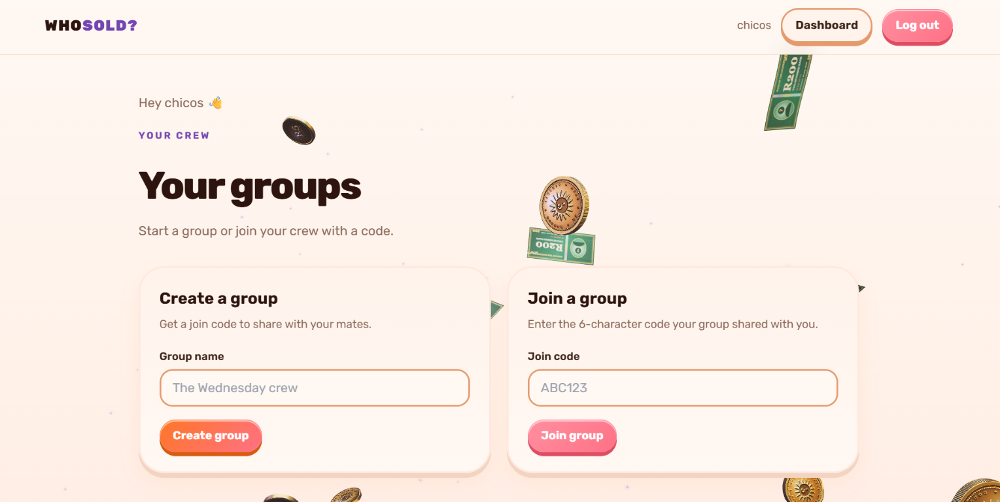

# WHOSOLD?

> A group of friends gets their wishlist funded by a mystery billionaire. Before the money drops, each friend secretly chooses to **Double** (take a quiz) or **Pass**. One lost quiz wipes the group's fund. Everyone finds out on release day.

**Team:** ChatGPT

## Live app

**https://whosold-seven.vercel.app/**

Open it in a private/incognito window and log in with one of the test accounts below.

## Test logins (test accounts only)

| Email | Password |
|-------|----------|
| alice@test.dev | Password123! |
| bob@test.dev | Password123! |
| cara@test.dev | Password123! |

- Demo group: **Demo Crew**, join code **DEMO42** (seeded with a two-item wishlist).
- New sign-ups need a real email domain (for example a Gmail address). Made-up domains are rejected.

## Demo and project board

- Team Loom (max 10 min): not yet linked.
- Project board: not yet linked.

## Screenshots

### Landing page


### How it works


### Groups dashboard



## How the game works

1. A friend group registers and builds **one shared wishlist**. The total is the group's **fund**, "funded" by the mystery billionaire.
2. The leader schedules a **choice window** and a **release time**.
3. Each member is asked **privately**: *Double or Pass?*
   - **Pass:** skip the quiz, no risk.
   - **Double:** take one quiz of 5 questions, 20 seconds each. Score at least 4 and the fund doubles once. Score 3 or fewer, or leave it unfinished, and the group loses its fund.
4. Nobody sees anyone else's choice. The group only sees a count like "3 of 5 have answered".
5. Members who don't respond by the close time are treated as **Pass**.
6. On release day the group sees whether the fund is **intact, grown or lost**, with a named breakdown.

All money in the app is **virtual**. No real payments are involved.

The full player-facing copy, privacy rules and timing live in [`docs/round-ux-contract.md`](docs/round-ux-contract.md).

## What works today

| Feature | Status |
|---------|--------|
| Sign up, log in, log out (Supabase Auth) | Working on the live link |
| Create a group, join with a code, lock a group | Working |
| Group wishlist: add, edit, delete, running fund total | Working |
| Row-level security: members only see their own groups and wishlists | Working, tested in CI |
| Double or Pass screens (choice, confirmation, submitted, schedule in SAST, disabled states) | UI shell merged; preview route is pending review in [PR #58](https://github.com/codingwithlebo/-WHOSOLD-/pull/58). Choices are not saved. |
| Saving choices, quiz scoring, release-day reveal | Not built yet |
| Round history | Waits for saved round data |

## Tech stack

- **Frontend:** React, TypeScript, Vite, Tailwind CSS, React Router, Motion
- **Backend:** Supabase (Postgres, Auth, row-level security, SQL functions)
- **Hosting:** Vercel (frontend) and a hosted Supabase project
- **Quality:** ESLint, Prettier, unit and component tests, pgTAP database tests, GitHub Actions CI
- **Design:** Stitch screens in [`docs/designs`](docs/designs)

## Getting started (local)

Requirements: Node (see `.nvmrc`) and npm.

```bash
npm install
cp .env.example .env
```

Fill in `.env` with the **Project URL** and the **publishable (anon) key** from Supabase, under Project Settings, then API:

```
VITE_SUPABASE_URL=
VITE_SUPABASE_ANON_KEY=
```

```bash
npm run dev
```

Use the publishable key only. **Never put the `service_role` key or the database password in the frontend or the repo.** The anon key is safe in the browser because row-level security protects the data.

Useful scripts:

| Command | What it does |
|---------|--------------|
| `npm run dev` | Start the app locally |
| `npm test` | Run the unit and component tests |
| `npm run lint` | Run ESLint |
| `npm run build` | Production build |
| `npm run db:start` | Start a local Supabase (needs Docker) |
| `npm run db:test` | Run the database tests |

## Database (Supabase)

The database is built from the repo, not by hand. Every change is a file in `supabase/migrations/`, reviewed in a pull request.

| Migration | What it adds |
|-----------|--------------|
| `20261115120000_profiles.sql` | Player profiles, with a trigger that creates one on sign-up |
| `20261119120000_groups.sql` | Groups, members, and the `create_group`, `join_group` and `lock_group` functions |
| `20261119130000_wishlist_items.sql` | The wishlist and its rules |

- `supabase/seed.sql` adds the demo data: Alice, Bob and Cara, and the Demo Crew group (code `DEMO42`).
- `supabase/tests/` has pgTAP tests for every rule (what is allowed and what is denied).
- On every pull request, CI starts a fresh Supabase database, applies all migrations and the seed, and runs those tests.

## Environments and deployment

- **Vercel** builds every push. Production variables are `VITE_SUPABASE_URL` and `VITE_SUPABASE_ANON_KEY`, and Vite reads them at build time, so a redeploy is needed after changing them.
- **Hosted Supabase:** database changes are pushed from the migrations with the Supabase CLI by the Tech Lead.

## How we work

- Branch protection for `main` is pending admin confirmation in [issue #7](https://github.com/codingwithlebo/-WHOSOLD-/issues/7).
- No direct pushes and no self-merges. Reviews say what the reviewer checked.
- Each PR uses the repo's pull request template.

## Project documents

| Document | What it covers |
|----------|----------------|
| [PRD](docs/PRD.md) | Product requirements |
| [Implementation plan](docs/IMPLEMENTATION_PLAN.md) | Phases and MVP defaults |
| [Round UX contract](docs/round-ux-contract.md) | Double or Pass copy, privacy and timing |
| [Test plan](docs/TEST_PLAN.md) | What we test and how |
| [Team](docs/TEAM.md) | Roles and responsibilities |
| [Designs](docs/designs/README.md) | Stitch screens |

## Team & roles

| Name | Role | GitHub |
|------|------|--------|
| Owethu Jezile | Product Owner, frontend and backend | [@Owethudev](https://github.com/Owethudev) |
| Mandla Sikhosana | Tech Lead, frontend and backend | [@mandlenkosii](https://github.com/mandlenkosii) |
| Malebo Nkuna | Designer and QA, frontend and backend | [@codingwithlebo](https://github.com/codingwithlebo) |
| Ntokozo Maselela | DevOps/Release, frontend and backend | [@shaunmaselela25](https://github.com/shaunmaselela25) |

## Who built what

| Member | Contributions (merged or in progress) |
|--------|---------------------------------------|
| Mandla Sikhosana | Hosted Supabase project, migrations, seed data, database tests and CI database checks |
| Owethu Jezile | Round UX contract, Double or Pass UI shell (#55), group and wishlist integration |
| Malebo Nkuna | Stitch designs, QA/test leadership, and round preview route work in progress (#58) |
| Ntokozo Maselela | CI pipeline and auth regression fixes (#16) |

## Known limitations

- The Double or Pass UI shell is merged, but its preview route is still under review in PR #58. Choices are not saved and the quiz is not built yet.
- Round history and the release-day reveal depend on the saved round data.
