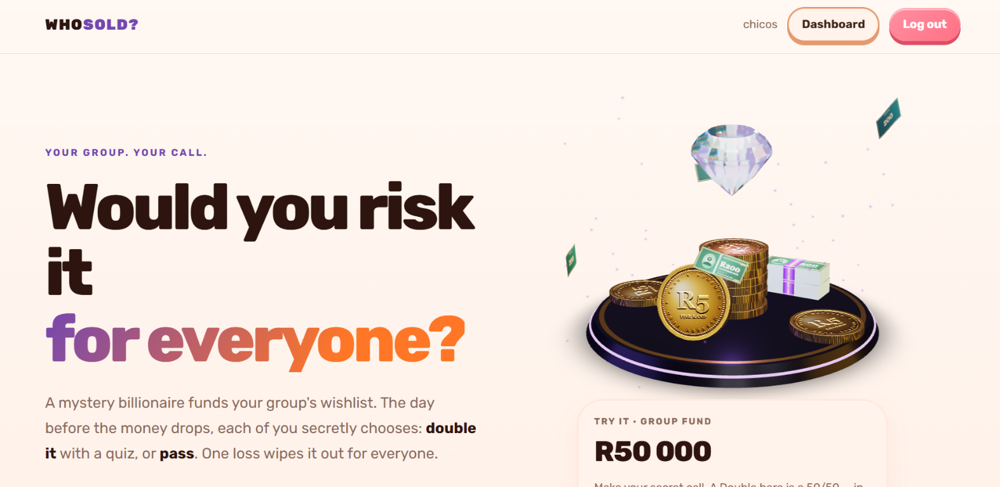
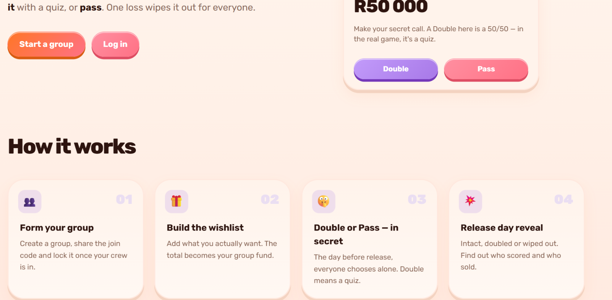

# WHOSOLD?

[](https://github.com/codingwithlebo/-WHOSOLD-/actions/workflows/ci.yml)

> A group of friends gets their wishlist funded by a mystery billionaire. Before the money drops, each friend secretly chooses to **Double** (take a quiz) or **Pass**. One lost quiz wipes the group's fund. Everyone finds out on release day.

**Team:** ChatGPT

## Live app

**https://whosold-seven.vercel.app/**

Open it in a private/incognito window and log in with one of the test accounts below.

## Test logins (test accounts only)

| Email          | Password     |
| -------------- | ------------ |
| alice@test.dev | Password123! |
| bob@test.dev   | Password123! |
| cara@test.dev  | Password123! |

- Demo group: **Demo Crew**, join code **DEMO42**, led by Alice, with a two-item wishlist (fund **R27 499.00**). Log in as Cara, or sign up, to try joining it.
- Please keep the demo usable for others: **don't lock Demo Crew** (locking can't be undone), and delete any wishlist items you add. To try locking, create your own group.
- New sign-ups need a real email domain (for example a Gmail address). Made-up domains such as `test.dev` can be rejected. New accounts are confirmed automatically, so no confirmation email is needed.

## Demo and project board

- Loom walkthroughs (each member records their own):
  - Mandla Sikhosana (Tech Lead, database and auth): https://www.loom.com/share/4014218c093d44d58aa719eb56866629
- Project board: [WHOSOLD project board](https://github.com/users/codingwithlebo/projects/1/views/1).

## Screenshots

### Landing page



### How it works



### Groups dashboard


## How the game works

1. A friend group registers and builds **one shared wishlist**. The total is the group's **fund**, "funded" by the mystery billionaire.
2. The leader schedules a **choice window** and a **release time**.
3. Each member is asked **privately**: _Double or Pass?_
   - **Pass:** skip the quiz, no risk.
   - **Double:** take one quiz of 5 questions, 20 seconds each. Score at least 4 and the fund doubles once. Score 3 or fewer, or leave it unfinished, and the group loses its fund.
4. Nobody sees anyone else's choice. The group only sees a count like "3 of 5 have answered".
5. Members who don't respond by the close time are treated as **Pass**.
6. On release day the group sees whether the fund is **intact, grown or lost**, with a named breakdown.

All money in the app is **virtual**. No real payments are involved.

The full player-facing copy, privacy rules and timing live in [`docs/round-ux-contract.md`](docs/round-ux-contract.md).

## What works today

| Feature                                                               | Status                                                                                          |
| --------------------------------------------------------------------- | ----------------------------------------------------------------------------------------------- |
| Sign up, log in, log out (Supabase Auth)                              | Working on the live link                                                                        |
| Create a group, join with a code, lock a group                        | Working                                                                                         |
| Group wishlist: add, edit, delete, running fund total                 | Working                                                                                         |
| Row-level security: members only see their own groups and wishlists   | Working, tested in CI                                                                           |
| Live Double or Pass rounds, private choices and server-scored quizzes | Merged in #61; the Supabase migration must be applied before this is available on the live app. |
| Release-time resolution and named results                             | Merged in #61; results resolve on request after the scheduled release time.                     |
| Round history                                                         | Waiting for the `get_history` RPC (#44) and live UI integration (#45)                           |

## Tech stack

- **Frontend:** React, TypeScript, Vite, Tailwind CSS, React Router, Motion
- **Backend:** Supabase (Postgres, Auth, row-level security, SQL functions)
- **Hosting:** Vercel (frontend) and a hosted Supabase project
- **Quality:** ESLint, Prettier, unit and component tests, pgTAP database tests, GitHub Actions CI
- **Design:** Stitch screens in [`docs/designs`](docs/designs)

## Getting started (local)

Requirements: Node (see `.nvmrc`) and npm.

```bash
npm install
cp .env.example .env
```

Fill in `.env` with the **Project URL** and the **publishable key** (`sb_publishable_…`) from Supabase, under Project Settings → API Keys:

```
VITE_SUPABASE_URL=
VITE_SUPABASE_ANON_KEY=
```

```bash
npm run dev
```

Use the publishable key only. **Never put the `service_role` key or the database password in the frontend or the repo.** The anon key is safe in the browser because row-level security protects the data.

Useful scripts:

| Command            | What it does                          |
| ------------------ | ------------------------------------- |
| `npm run dev`      | Start the app locally                 |
| `npm test`         | Run the unit and component tests      |
| `npm run lint`     | Run ESLint                            |
| `npm run build`    | Production build                      |
| `npm run db:start` | Start a local Supabase (needs Docker) |
| `npm run db:test`  | Run the database tests                |

## Database (Supabase)

The database is built from the repo, not by hand. Every change is a file in `supabase/migrations/`, reviewed in a pull request.

| Migration                           | What it adds                                                                     |
| ----------------------------------- | -------------------------------------------------------------------------------- |
| `20261115120000_profiles.sql`       | Player profiles, with a trigger that creates one on sign-up                      |
| `20261119120000_groups.sql`         | Groups, members, and the `create_group`, `join_group` and `lock_group` functions |
| `20261119130000_wishlist_items.sql` | The wishlist and its rules                                                       |
| `20261120100000_round_gameplay.sql` | Private rounds and choices, server-scored quizzes, and release-time results      |

- `supabase/seed.sql` adds the demo data: Alice, Bob and Cara, and the Demo Crew group (code `DEMO42`).
- `supabase/tests/` has pgTAP tests for every rule (what is allowed and what is denied).
- On every pull request, CI starts a fresh Supabase database, applies all migrations and the seed, and runs those tests.

## Environments and deployment

- **Vercel** builds every push. Production variables are `VITE_SUPABASE_URL` and `VITE_SUPABASE_ANON_KEY`, and Vite reads them at build time, so a redeploy is needed after changing them.
- **Hosted Supabase:** database changes are pushed from the migrations with the Supabase CLI by the Tech Lead.
- **Production** auto-deploys from `main` to <https://whosold-seven.vercel.app>. PR previews are protected and need a Vercel team login.
- Release checklist, live smoke test, rollback, scheduled-resolution monitoring and incident handling are in the [operations runbook](docs/OPERATIONS.md).

## Checks and CI

Run the same gate CI runs before pushing:

```bash
npm run verify   # format:check → lint → typecheck → test:ci → build
```

| Script                 | What it does                                                 |
| ---------------------- | ------------------------------------------------------------ |
| `npm run format:check` | Prettier check on the whole repo (`npm run format` to fix)   |
| `npm run lint`         | Type-aware ESLint, zero warnings allowed (`lint:fix` to fix) |
| `npm run typecheck`    | `tsc -b` across app and tooling projects                     |
| `npm run test:ci`      | Vitest, single run (`npm test` for watch mode)               |
| `npm run build`        | Typecheck + production Vite build                            |
| `npm run check:dist`   | Fails if `dist/` contains secret keys or quiz-answer fields  |

[`.github/workflows/ci.yml`](.github/workflows/ci.yml) runs on pull requests to `main`, pushes to `main`, the merge queue and manual dispatch. Jobs run in parallel:

- **Lint workflows**: actionlint + shellcheck on the workflow files
- **Format**, **Lint**, **Typecheck**, **Unit tests**, **Build** (runs `check:dist`, then uploads `dist/`)
- **Dependency audit**: registry signature check and `npm audit` (high+) on production dependencies
- **Dependency review** (PRs only, needs the repo's Dependency graph enabled; skipped with a warning otherwise): blocks newly added vulnerable or copyleft-licensed packages
- **Database tests**: `supabase start` (applies migrations + seed) then `supabase test db` (pgTAP)
- **CI passed**: aggregates all of the above. Make this the single required status check in branch protection.

Actions are pinned to commit SHAs, the workflow token is read-only, and stale runs on the same PR are cancelled. Dependabot opens weekly grouped PRs for npm packages and actions.

## How we work

- Branch protection for `main` is pending admin confirmation in [issue #7](https://github.com/codingwithlebo/-WHOSOLD-/issues/7).
- No direct pushes and no self-merges. Reviews say what the reviewer checked.
- Each PR uses the repo's pull request template.
- Get at least one teammate's approval and a passing CI run before merging.
- Branch naming: `feature/<short-name>` or `fix/<short-name>`.

## Project documents

| Document                                                         | What it covers                                                                                                                                               |
| ---------------------------------------------------------------- | ------------------------------------------------------------------------------------------------------------------------------------------------------------ |
| [PRD](docs/PRD.md)                                               | Product requirements                                                                                                                                         |
| [Implementation plan](docs/IMPLEMENTATION_PLAN.md)               | Phases and MVP defaults                                                                                                                                      |
| [Round UX contract](docs/round-ux-contract.md)                   | Double or Pass copy, privacy and timing                                                                                                                      |
| [Test plan](docs/TEST_PLAN.md)                                   | What we test and how                                                                                                                                         |
| [Operations runbook](docs/OPERATIONS.md)                         | Deploy, env, rollback, scheduled resolution, incidents                                                                                                       |
| [`get_reveal` contract (proposed)](docs/contracts/get-reveal.md) | Reveal API shape                                                                                                                                             |
| [Phase 10 discovery](docs/PHASE_10_DISCOVERY.md)                 | Group round history proposal                                                                                                                                 |
| [Team](docs/TEAM.md)                                             | Roles and responsibilities                                                                                                                                   |
| Delivery checklists                                              | [Mandla](docs/team/mandla-sikhosana.md), [Owethu](docs/team/owethu-jezile.md), [Malebo](docs/team/malebo-nkuna.md), [Ntokozo](docs/team/ntokozo-maselela.md) |
| [Designs](docs/designs/README.md)                                | Stitch screens                                                                                                                                               |

## Team & roles

| Name             | Role                                  | GitHub                                                 |
| ---------------- | ------------------------------------- | ------------------------------------------------------ |
| Owethu Jezile    | Product Owner, frontend and backend   | [@Owethudev](https://github.com/Owethudev)             |
| Mandla Sikhosana | Tech Lead, frontend and backend       | [@mandlenkosii](https://github.com/mandlenkosii)       |
| Malebo Nkuna     | Designer and QA, frontend and backend | [@codingwithlebo](https://github.com/codingwithlebo)   |
| Ntokozo Maselela | DevOps/Release, frontend and backend  | [@shaunmaselela25](https://github.com/shaunmaselela25) |

## Who built what

| Member           | Contributions (merged or in progress)                                                                                                                                                                                                                                                                                   |
| ---------------- | ----------------------------------------------------------------------------------------------------------------------------------------------------------------------------------------------------------------------------------------------------------------------------------------------------------------------- |
| Mandla Sikhosana | Hosted Supabase project; profiles, groups and wishlist migrations with row-level security and database functions (#11, #37, #39); seed data and pgTAP database tests; log-in/sign-up screens and the 3D landing page (#6); auth session tests (#48); `get_history` API contract (#49); PR reviews and live-link testing |
| Owethu Jezile    | Round UX contract, Double or Pass UI shell (#55), group and wishlist integration                                                                                                                                                                                                                                        |
| Malebo Nkuna     | Stitch designs, QA/test leadership, and round preview route work in progress (#58)                                                                                                                                                                                                                                      |
| Ntokozo Maselela | CI pipeline and auth regression fixes (#16)                                                                                                                                                                                                                                                                             |

## Known limitations

- Live gameplay code is merged in #61. The database owner must apply its migration to hosted Supabase before the live app can start rounds; production migration status has not been confirmed.
- Round history awaits the live `get_history` RPC (#44) and UI integration
  (#45). Live gameplay still requires the hosted Supabase migration to be
  applied.
