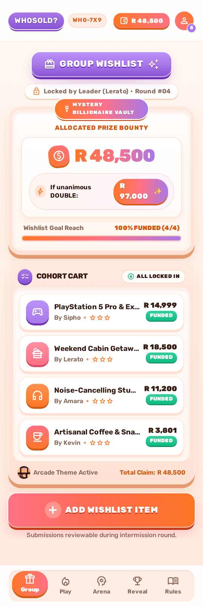
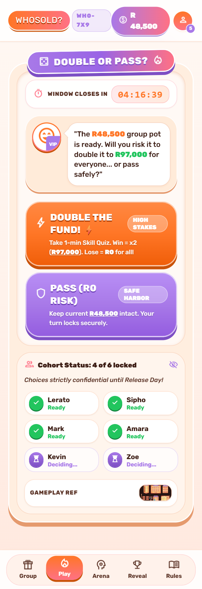
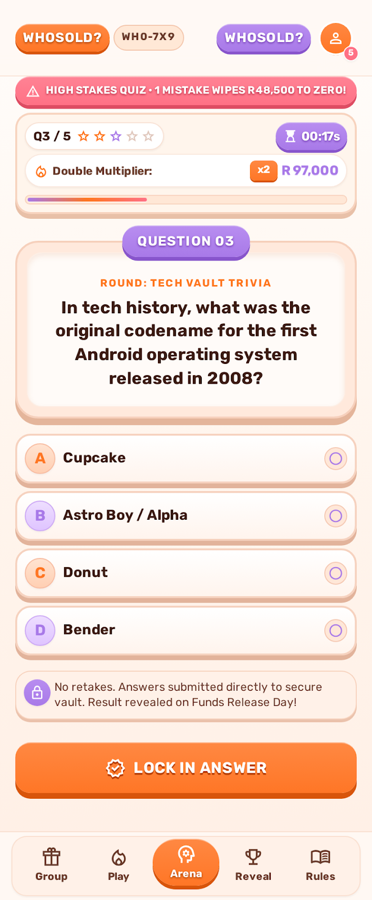
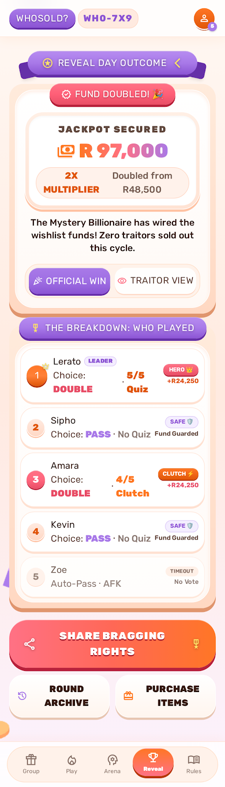

# Designs

The current WHOSOLD? concept is in the
[Stitch project](https://stitch.google.com/projects/10560530829481209593).

Stitch exports are available in
[`stitch_interactive_3d_app_screens/`](stitch_interactive_3d_app_screens/).
Each screen folder contains a PNG preview and its HTML export:

| Screen | Preview | HTML export |
| --- | --- | --- |
| Group wishlist fund |  | [code.html](stitch_interactive_3d_app_screens/whosold_group_wishlist_fund/code.html) |
| Double or pass decision |  | [code.html](stitch_interactive_3d_app_screens/whosold_double_or_pass_decision/code.html) |
| Quiz stakes arena |  | [code.html](stitch_interactive_3d_app_screens/whosold_quiz_stakes_arena/code.html) |
| Release day reveal |  | [code.html](stitch_interactive_3d_app_screens/whosold_release_day_reveal/code.html) |

The shared [Sunset Arcade design system](stitch_interactive_3d_app_screens/sunset_arcade/DESIGN.md)
is included with the exports. These are reference designs; the app shell remains
a temporary implementation scaffold, and the exports have not yet been reviewed
or approved as final design sign-off.
